# ShopEasy: Complete Project Documentation

An enterprise-style e-commerce platform (storefront, checkout and payments, inventory, admin back office, analytics) built module by module to learn production engineering: concurrency, caching, queues, search performance, containers and CI/CD.

> **Diagrams** are written in Mermaid. They render automatically on GitHub and in VS Code (with a Mermaid preview extension).
> Related files: `PROJECT_DOC.md` (the original brief), `PROJECT_PROGRESS.md` (decision log per module), `backend/PERFORMANCE.md` (measurements), `DEPLOYMENT.md` (run and deploy steps).

---

## Table of contents
1. [What the system does](#1-what-the-system-does)
2. [Technology stack and why each tool](#2-technology-stack-and-why-each-tool)
3. [System architecture](#3-system-architecture)
4. [Code organisation](#4-code-organisation)
5. [Data model](#5-data-model)
6. [Core flows (diagrams)](#6-core-flows)
7. [Technical implementation, by topic](#7-technical-implementation-by-topic)
8. [API reference](#8-api-reference)
9. [Frontend](#9-frontend)
10. [Docker and containers](#10-docker-and-containers)
11. [CI/CD](#11-cicd)
12. [Deployment on Render](#12-deployment-on-render)
13. [Configuration reference](#13-configuration-reference)
14. [Testing](#14-testing)
15. [Operations runbook](#15-operations-runbook)
16. [Design decisions and trade-offs](#16-design-decisions-and-trade-offs)
17. [Known gaps and roadmap](#17-known-gaps-and-roadmap)

---

## 1. What the system does

| Area | Capabilities |
|---|---|
| **Accounts** | Register, email verification, login, refresh-token rotation, password reset/change, profile, saved addresses |
| **Catalog** | Products, categories (tree), brands, images (Cloudinary), full-text search, filters, sorting, cursor pagination |
| **Inventory** | On-hand / reserved / available stock, time-limited reservations, stock ledger, low-stock alerts, manual adjustments |
| **Cart and checkout** | Server-side cart, price/stock validation, idempotent checkout, shipping rules, order snapshots |
| **Payments** | Stripe PaymentIntents (embedded Payment Element), signed webhooks, refunds, reconciliation |
| **Orders** | Lifecycle (pending, paid, processing, shipped, delivered, cancelled, refunded), history, admin status changes |
| **Notifications** | Transactional emails through a reliable outbox + queue (Resend) |
| **Admin** | Analytics, orders, products, inventory, categories, brands, users and roles, emails, queue dashboard, diagnostics |
| **Operations** | Structured logs, health/readiness, graceful shutdown, Docker, CI, Render blueprint |

**Roles**

| Role | Can do |
|---|---|
| `CUSTOMER` | Shop, cart, checkout, own orders and profile |
| `ADMIN` | Everything operational: products, stock, orders, analytics, enable/disable **customer** accounts |
| `SUPER_ADMIN` | All of the above plus change roles and manage staff accounts. Cannot change their own role/status (so one always remains) |

---

## 2. Technology stack and why each tool

### Backend
| Tool | Version | Used for | Why this and not something else |
|---|---|---|---|
| **Node.js** | 22 (Docker) | Runtime | One language end to end; non-blocking I/O suits an API that mostly waits on the DB and network |
| **TypeScript** | 5.x | Language | Types catch whole classes of bugs before runtime; shared mental model with the frontend |
| **Express** | 5 | HTTP framework | Minimal and ubiquitous; v5 forwards rejected promises in async handlers to the error handler automatically |
| **PostgreSQL** (via **pg**) | 16 / pg 8 | Primary database | Relational integrity, transactions, row locks, partial/composite/GIN indexes, full-text search, window functions, materialized views |
| **Zod** | 4 | Input validation | One schema validates and types request bodies/queries (trust boundary) |
| **bcrypt** | 6 | Password hashing | Slow, salted hash (cost 12); only the hash is stored |
| **jsonwebtoken** | 9 | Access tokens | Short-lived (15 min) stateless tokens carrying the user id and roles |
| **Redis** via **ioredis** | 7 / 6 | Cache, rate limits, revocation, locks, queue backend | In-memory speed; atomic Lua scripts; BullMQ needs it |
| **BullMQ** | 6 | Background jobs | Reliable Redis-backed queues: retries with backoff, priorities, repeatable schedulers, one run per tick across many workers |
| **Bull Board** | 9 | Queue dashboard | See, retry and inspect jobs without writing tooling |
| **Stripe** (stripe-node) | 23 | Payments | PaymentIntents + Payment Element; signed webhooks; idempotency keys; test mode |
| **Resend** (HTTPS API) | n/a | Email delivery | Simple API and generous free tier; called with `fetch`, no SDK |
| **Cloudinary** | 2 | Image storage and CDN | Signed **direct** uploads (the API never handles file bytes); on-the-fly resizing and format conversion |
| **pino** + **pino-http** | 10 / 11 | Logging | Fast structured JSON logs, request ids, redaction |
| **swagger-ui-express** | 5 | API docs | Interactive OpenAPI docs at `/api/docs` |
| **dotenv** | 18 | Config | Local development environment |
| **tsx** | n/a | Dev runner / test runner | Runs TypeScript directly (`tsx watch`, `tsx --test`) |
| **node:test** | built in | Testing | Built-in runner: no extra framework |

### Frontend
| Tool | Version | Used for |
|---|---|---|
| **Next.js** (App Router) | 16.4 | Pages, server rendering, runtime `/api` proxy (`src/proxy.ts`), standalone production build |
| **React** | 19 | UI |
| **TanStack Query** | 5 | Server-state cache, loading/error states, infinite "Load more" |
| **Tailwind CSS** | 4 | Styling (custom design tokens: ivory, ink, gold) |
| **Stripe.js + React Stripe** | 10 / 7 | Embedded Payment Element |
| **lucide-react** | 1.x | Icons |

### Infrastructure and tooling
| Tool | Purpose |
|---|---|
| **Docker + Docker Compose** | Reproducible multi-container environment (Postgres, Redis, API, worker, web) |
| **GitHub Actions** | CI: typecheck, tests (with real Postgres/Redis), builds, Docker image builds |
| **Render** | Hosting (Blueprint `render.yaml`): API, web, Redis-compatible Key Value |
| **Supabase** | Managed Postgres (session pooler) in development and on Render |
| **k6** (Grafana, via Docker) | Load testing (see `backend/perf/`) |
| **Git / GitHub** | Version control; feature branches per module |

---

## 3. System architecture

### 3.1 Runtime view

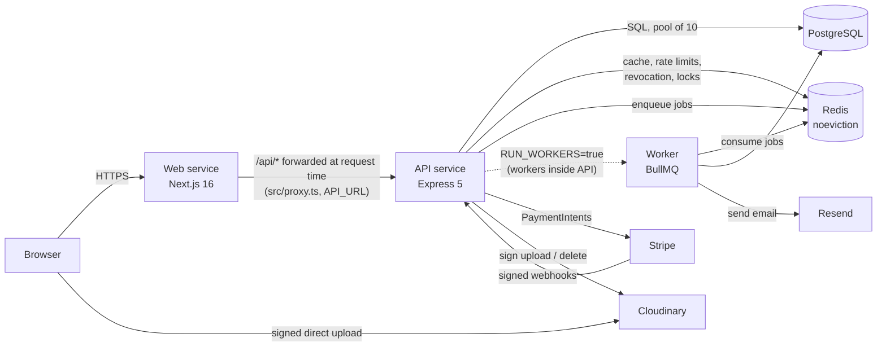

Key idea: the browser only ever talks to **one origin** (the web service). The `/api/*` calls are forwarded server to server, so there is no CORS problem and the API address is never exposed or baked into the JavaScript bundle.

### 3.2 Layered backend (per module)

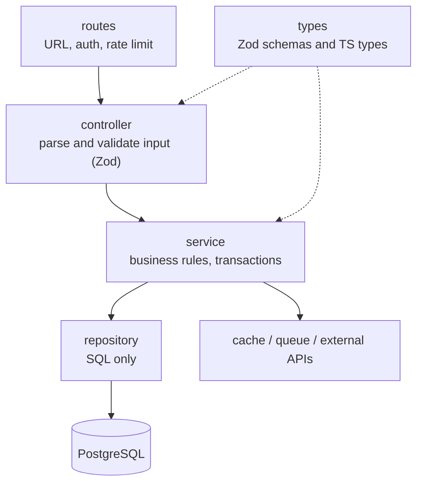

Each layer has one job: routes decide **who may call what**, controllers translate HTTP to function calls, services hold **business rules and transaction boundaries**, repositories hold **only SQL**. This keeps SQL out of business logic and HTTP out of both.

### 3.3 Request pipeline (every API call)

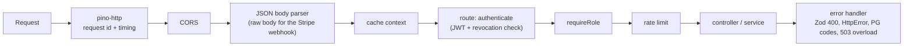

---

## 4. Code organisation

```
enterprise_ecommerece/
├── backend/
│   ├── db/schema.sql                 idempotent schema (tables, indexes, views, seed roles)
│   ├── perf/                         benchmark seed, EXPLAIN harness, k6 scripts, results
│   ├── Dockerfile · .dockerignore
│   └── src/
│       ├── app.ts · server.ts · worker.ts
│       ├── config/                   db.ts (pool, stats, timeouts), redis.ts, queue.ts, stripe.ts, cloudinary.ts, logger.ts
│       ├── middlewares/              authenticate.ts (JWT, roles), errorHandler.ts
│       ├── utils/                    jwt, httpError, revocation, rateLimit, slug, money helpers
│       ├── jobs/                     workers.ts, schedule.ts, cleanup.ts
│       ├── docs/openapi.ts           Swagger spec
│       └── modules/                  routes · controller · service · repository · types (+ tests)
│           auth, users, products, categories, manufacturers, inventory, cart, orders,
│           payments, notifications, uploads, cache, analytics, admin-users, diagnostics
├── frontend/
│   ├── Dockerfile · next.config.ts
│   └── src/ app/ (pages) · components/ · lib/ (api, auth, cart, hooks, types, format) · proxy.ts
├── docker-compose.yml · render.yaml · .github/workflows/ci.yml
└── DOCUMENTATION.md · DEPLOYMENT.md · PROJECT_DOC.md · PROJECT_PROGRESS.md · backend/PERFORMANCE.md
```

---

## 5. Data model

### 5.1 Entity relationships (core)

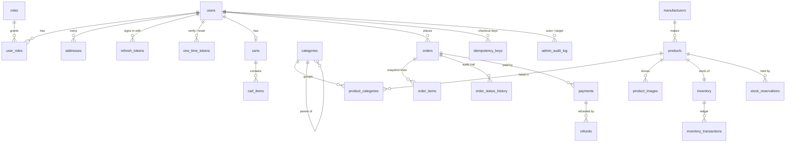

Supporting tables: `stripe_events` (webhook de-duplication), `email_log` (the email outbox), `admin_audit_log`.

### 5.2 Notable design choices in the schema
- **Money** is `numeric(12,2)`; Stripe amounts are integer cents. A `CHECK (total = subtotal + shipping + tax)` makes the database enforce that the books add up.
- **Orders snapshot** everything that can change later: addresses (jsonb), customer email, and each line's `sku`, `name`, `unit_price`. Editing or deleting a product never rewrites history. `order_items.product_id` is `ON DELETE SET NULL`.
- **Order numbers** are random, not sequential, so they can't be guessed.
- **Constraints do the policing**: `UNIQUE` (sku, slug, email, `provider_intent_id`, `(payment_id, reason)` for refunds, `dedupe_key` for emails), `CHECK` for statuses and quantities, foreign keys with deliberate `ON DELETE` rules.
- **Indexes** (31): partial indexes `WHERE is_active`, composite `(price, id)`, `(name, id)`, `(manufacturer_id, created_at DESC, id DESC)`, a GIN full-text index, and covering `(category_id, product_id)`.
- **Views**: `recognised_orders` (paid and not cancelled/refunded: the single definition of revenue). **Materialized view** `sales_daily` (unique index so it can refresh `CONCURRENTLY`).

---

## 6. Core flows

### 6.1 Registration, verification and login

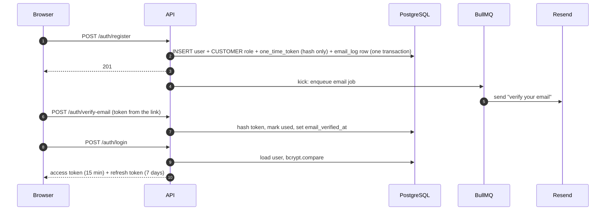

### 6.2 Access and refresh tokens (rotation with reuse detection)

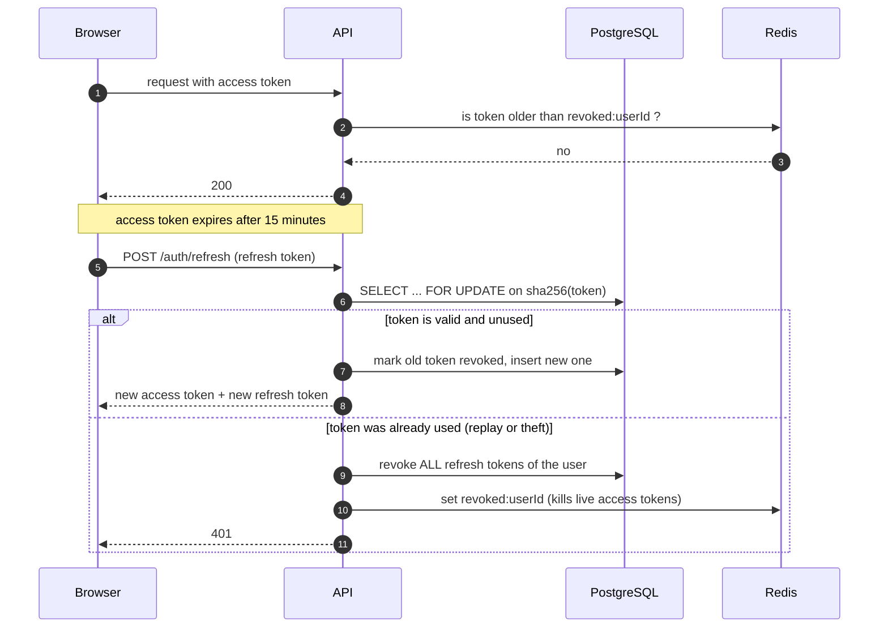

### 6.3 Browsing and search (caching + keyset pagination)

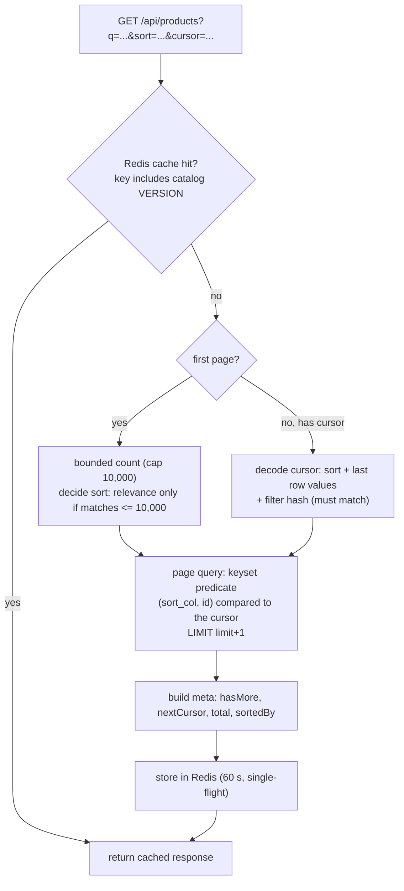

### 6.4 Checkout and payment (the money path)

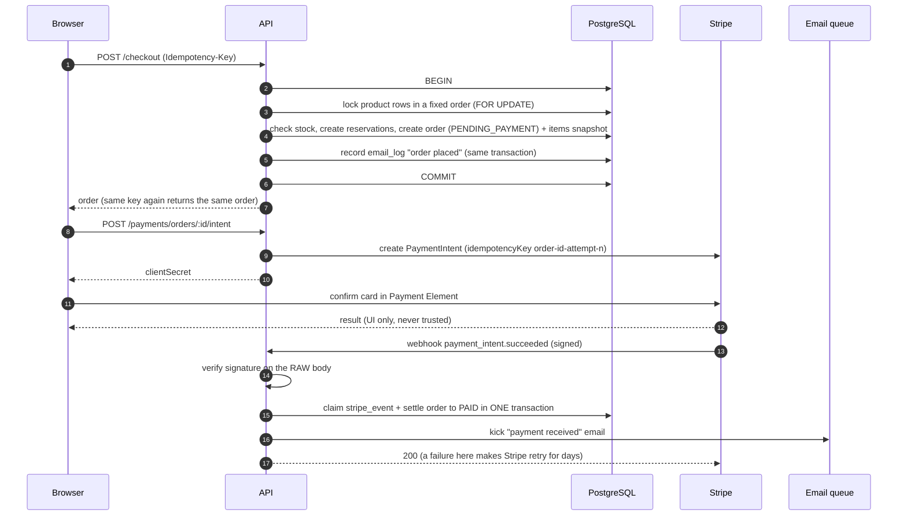

The browser's "success" is only a hint. **The webhook is the source of truth.** A reconciler job also polls Stripe for stuck payments every 5 minutes.

### 6.5 Order state machine

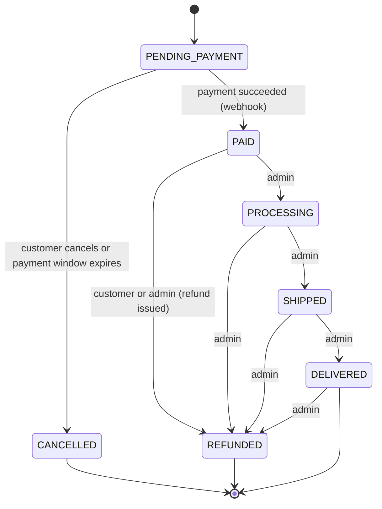

### 6.6 Email: transactional outbox

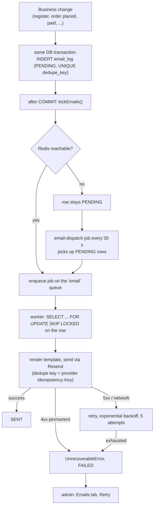

Why an outbox: if the app wrote the order and then crashed before queueing the email (or Redis was down), a plain "enqueue after save" would lose the email forever. Writing the email row **in the same transaction as the business change** makes "decided to send" durable; delivery then becomes a retryable, idempotent background step.

### 6.7 Stock reservation lifecycle

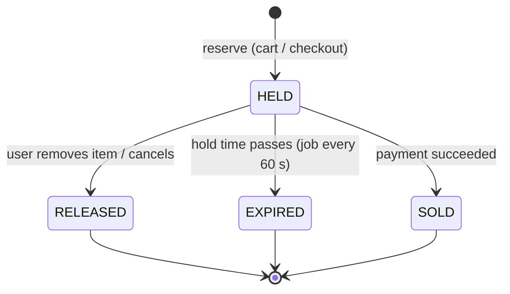
`available = on_hand - reserved`. Every change writes an `inventory_transactions` ledger row (RESTOCK, RETURN, DAMAGED, CORRECTION, RESERVE, RELEASE, EXPIRE, SALE, INITIAL).

### 6.8 CI/CD pipeline

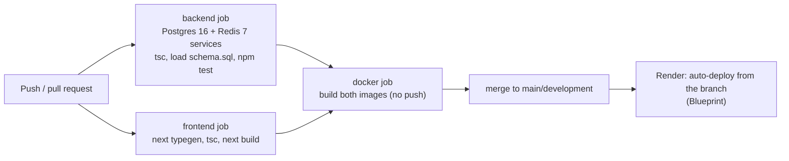

---

## 7. Technical implementation, by topic

### 7.1 Authentication and security
- **Passwords**: bcrypt cost 12; only the hash is stored. Login errors are identical for "no such user", "wrong password" and "disabled" (no account enumeration).
- **Access token**: JWT, 15 minutes, carries `sub` and `roles`. **Refresh token**: 32 random bytes; only its **SHA-256 hash** is stored (a database leak does not leak usable tokens); 7 days; **rotation** (single use) with **reuse detection** (a replayed token revokes every session of that user).
- **Concurrent refresh**: the refresh row is read `FOR UPDATE`, so two simultaneous refreshes with the same token are serialized.
- **Immediate revocation**: JWTs are stateless, so on password change/reset, token reuse, account disable or role change we write one Redis key `revoked:<userId>` = a timestamp (TTL 16 min). `authenticate` rejects any token issued before it. Resolution is one second, so a token minted in the same second as the revocation survives (documented trade-off). If Redis is down it **fails open** (a revocation could be missed for up to 15 minutes).
- **Verification / reset tokens**: random, hashed at rest, single-use, expiring (`one_time_tokens`). Links are wiped from the email log after sending.
- **Authorization**: `requireRole` at the router; ownership checks in SQL (`WHERE id = $1 AND user_id = $2`), so users cannot touch each other's rows. Admin vs super-admin rules live in the service and are audited.
- **Rate limiting** (Redis sliding-window log, one atomic Lua script, time taken from Redis): login 10 per 15 min per IP+email, register 20/h per IP, forgot-password 5/h, reset 10/h, refresh 120/min, checkout 20/min per user, payment intent 30/min per user. Returns `429` with `Retry-After`. `TRUST_PROXY` must equal the number of proxies in front of the API so `req.ip` is the real visitor.
- **Input validation**: Zod at every controller; PG errors (`23505` duplicate, `23503` FK, `23514` check) are mapped to clean 409/400.
- **Never leaked**: stack traces (500s say "Internal server error"; detail goes to the log with the request id), passwords, tokens in logs.

### 7.2 Inventory and concurrency (no overselling)
- Stock changes happen in a transaction that locks the product's inventory row `FOR UPDATE`. Two buyers of the last unit queue on the lock; the second sees `available = 0` and is told.
- **Deadlock prevention**: when several products are locked, they are locked **in sorted id order**, so two carts asking for `[P,Q]` and `[Q,P]` cannot deadlock (tested with 20 concurrent requests).
- **Retries**: `withTransaction(fn, { retries })` retries on deadlock (`40P01`) and serialization failure (`40001`).
- **Reservations** hold units for a time; a scheduled job expires stale holds. Stock available to others = on hand minus reserved.
- Every movement is an immutable ledger row, so on-hand can always be explained.
- **Low-stock alerts**: crossing a product's threshold emails admins (max 1 per product per admin per hour).

### 7.3 Checkout, idempotency, pricing
- The client sends an `Idempotency-Key`; `(user_id, key)` is unique, so retrying (double click, flaky network) returns the **same order**, never a second one.
- Prices come from the database, never from the client. Shipping: flat rate, free from $100.00 (`pricing.ts`); tax rate currently 0 (prices tax-inclusive).
- The order, its line snapshots, the reservation links and the "order placed" email row are written in **one transaction**: a failed checkout leaves nothing behind.
- Unpaid orders expire after `ORDER_PAYMENT_WINDOW_MINUTES` (default 30); a job cancels them and releases stock.

### 7.4 Payments (Stripe)
- **PaymentIntent per order attempt** with Stripe-side idempotency key `order-<id>-attempt-<n>`; a declined card retries on the same intent.
- **Webhook** `POST /api/payments/webhook` uses `express.raw` (Stripe signs the exact bytes, so JSON parsing before verification would break it). Signature verified with the webhook secret.
- **Exactly-once effect**: the event id is *claimed* (`stripe_events`) and the order is settled **in one transaction**. If anything throws, the claim rolls back, we answer 500, and Stripe redelivers. Duplicates and out-of-order deliveries are no-ops (state-based logic).
- **Amount check**: if Stripe reports an amount/currency different from ours, nothing is applied and it is flagged for a human.
- **Late payment** (money taken for an expired/cancelled order): a refund is queued automatically.
- **Refund outbox**: the intent to refund is recorded with the business change (`refunds`, `UNIQUE (payment_id, reason)`), executed and retried separately.
- **Reconciler** (every 5 min, only when Stripe is configured) heals payments whose webhook never arrived.
- The browser redirect after payment triggers a *sync* call; it is a convenience, never the authority.

### 7.5 Redis: every use, and why it is safe
Redis is **an optimisation, never a dependency**: every call goes through `safe()` (fail fast, 5 s circuit breaker, `enableOfflineQueue: false`, 300 ms command timeout).

| Use | How | If Redis is down |
|---|---|---|
| **Response cache** (cache-aside) | Product list 60 s, product detail 120 s, categories/brands 600 s; keys embed a catalog **VERSION** | Go straight to the DB (`X-Cache: BYPASS`) |
| **Invalidation** | Every write bumps the VERSION **after commit** (`afterWrite`); old keys are orphaned in O(1), with no SCAN/DEL. A reader reads the version **before** loading, so a slow reader overlapping a write stores under the old version and can't poison the cache | n/a |
| **Stampede protection** | In-process single-flight + Redis `SET NX PX` lock across instances; ±10% TTL jitter | Each caller loads itself |
| **Rate limiting** | Sorted-set sliding window in one Lua script | Fails open (availability over strictness) |
| **Token revocation** | `revoked:<userId>` timestamp | Fails open (≤15 min window) |
| **Distributed lock** | `withLock` (SET NX PX + owner-checked release) for the payment reconciler. Known limit: if the holder outlives the TTL a second holder can enter; correctness stays with DB constraints | Skip |
| **BullMQ backend** | Queues, schedulers | Emails stay PENDING in the DB; timers fall back |

Operational rules: Redis must use **`maxmemory-policy noeviction`** (BullMQ refuses to trust anything else, since evicting a queue key loses jobs). In production use two instances: cache (eviction allowed) and queues (`noeviction`). Keys are prefixed (`REDIS_KEY_PREFIX`, `QUEUE_PREFIX`) so environments/tests don't collide.

### 7.6 Background jobs (BullMQ)
- **Queues**: `email` (priority, 5 attempts, exponential backoff starting at 5 s) and `maintenance`.
- **Scheduled jobs** (job schedulers: idempotent upserts, one run per tick across all workers):

| Job | Every | Purpose |
|---|---|---|
| `expire-reservations` | 60 s | Release stale stock holds |
| `expire-orders` | 60 s | Cancel unpaid orders past the window |
| `email-dispatch` | 30 s | Deliver PENDING emails (heals lost jobs / Redis blips) |
| `refresh-sales` | 5 min | `REFRESH MATERIALIZED VIEW CONCURRENTLY sales_daily` |
| `reconcile-payments` | 5 min | Heal payments missing a webhook (only if Stripe is configured) |
| `cleanup` | daily 03:00 | Delete expired tokens, old idempotency keys (3 d), Stripe events (30 d), sent emails (30 d) |

- **Where workers run**: inside the API by default (`RUN_WORKERS` unset/true), or separately (`RUN_WORKERS=false` on the API and a `worker` process running `node dist/worker.js`). Both shut down cleanly (`workers.close()`).
- **If Redis is unreachable at boot**, the server falls back to in-process timers so reservations/orders still expire.
- **Bull Board** at `/api/admin/queues` (HTTP basic auth; user `admin`, password `BULL_BOARD_PASSWORD`; **returns 404 when the variable is unset**, on purpose).

### 7.7 Email (Resend)
- Templates: verify-email, password-reset, order-placed, order-paid, order-shipped, order-delivered, order-cancelled, order-refunded, low-stock (to admins). All HTML is escaped.
- Provider: Resend when `RESEND_API_KEY` is set, otherwise the console (dev). `EMAIL_FROM` defaults to `ShopEasy <onboarding@resend.dev>`, which only delivers to the Resend account owner until you verify your own domain.
- The `email_log` table is the outbox and the audit trail; the admin **Emails** tab shows status, errors, attempts and a Retry button.
- Permanent errors (HTTP 4xx except 409/429) are not retried.

### 7.8 Image uploads (Cloudinary)
- Admin asks `POST /api/admin/uploads/sign` for a **short-lived signature** (folder and allowed formats are part of the signature); the browser uploads **directly** to Cloudinary (the API never handles file bytes and the API secret never leaves the server).
- A `publicId` is accepted only if it lives in our folder **and** the URL belongs to our cloud. Deleting an image deletes the stored file (best-effort). Unsaved uploads are discarded via `/uploads/discard`.
- The frontend adds `f_auto,q_auto,c_limit,w_N` so thumbnails are small WebP/AVIF files.

### 7.9 Search and performance (Module 9)
Problem: with 1,000,000 products the default page took **2.8 s**. Cause: `COUNT(*) OVER()` forced a scan of every matching row just to print a total.

| Technique | Detail |
|---|---|
| **Bounded count** | `count(*) FROM (SELECT 1 … LIMIT 10001)`: exact to 10,000, then "10,000+" |
| **Keyset (cursor) pagination** | `WHERE (col, id) < (last_col, last_id) ORDER BY col DESC, id DESC LIMIT n+1`: same cost on page 1 and page 5000; stable while data changes. Cursor is opaque base64url and carries a hash of its filters (can't be replayed on another search); tampering returns 400 |
| **Tie-breaker `id`** | Equal prices/timestamps have no defined order; `id` makes it total, so pages never repeat or skip |
| **Partial composite indexes** | One per sort, `WHERE is_active`; `(manufacturer_id, created_at DESC, id DESC)`; `(category_id, product_id)` |
| **Bounded relevance** | `ts_rank` only when ≤ 10,000 matches; otherwise newest-first and `meta.sortedBy` says so |
| **Offset cap** | Page numbers to 10,000 rows deep, beyond that 400 "use the cursor" |
| **N+1 guard** | List = 2 queries for any page size, detail = 1, cart = 1 (asserted in tests by counting queries) |
| **Pool and limits** | `PG_POOL_MAX` (10), connect timeout 5 s → **503 + Retry-After**, per-connection `statement_timeout` 15 s → 503, slow-query log ≥ 250 ms (SQL text only) |

Measured (1M rows): default page 2,769 ms → ~2 ms; deep page 1,631 → 0.1 ms; k6 with 30 users: 1.7 → **700 req/s**, p95 22.7 s → 86 ms (10,452 req/s and 4.6 ms p95 with the Redis cache). Full tables in `backend/PERFORMANCE.md`.

### 7.10 Analytics and reporting (Module 10)
- **`recognised_orders` view**: paid and not cancelled/refunded. Every report reads it, so "revenue" has exactly one definition.
- **`sales_daily` materialized view**: pre-aggregated per day, refreshed every 5 minutes (`CONCURRENTLY`, so readers aren't blocked). The revenue series can lag up to 5 minutes; the summary is live.
- SQL concepts in use: GROUP BY, **HAVING** (`minUnits`, `minOrders`), **window functions** (`rank()`, running total `sum() OVER`, `lag()` growth, share of total `sum(sum(x)) OVER ()`), **CTEs** with `generate_series` + LEFT JOIN (fills empty days with zeros), views, materialized views, `LATERAL`.
- Endpoints: summary (vs previous period), revenue series (day/week/month), best sellers, top customers. Windows are half-open UTC days; ranges capped at one year.

### 7.11 User administration
- List with search/role/status filters, lifetime orders and spend (via `LATERAL` over `recognised_orders`).
- **Disable account**: sets `is_active=false`, revokes all refresh tokens, writes a Redis revocation (existing access tokens die at once), and logs to `admin_audit_log`, all consistent (DB parts in one transaction).
- **Change roles** (super admin only, never your own): replaces the role set, revokes the token so the new roles apply at once, audited with from/to.

### 7.12 Logging and monitoring
- **pino** JSON lines to stdout (the contract every platform understands). One line per request with `req.id`, method, path (no query string, which can carry tokens), status, response time. Level by status: `info` < 400, `warn` 4xx, `error` 5xx.
- **Request id**: generated, or taken from a valid incoming `X-Request-Id`; returned as the `X-Request-Id` header so a user can quote it and you can find the exact logs.
- **Redaction**: `Authorization`, cookies and `Stripe-Signature` never appear.
- 5xx include the full error object with the request id (`unhandled error`). Probes (`/api/health`, `/api/ready`) are not logged.
- `LOG_LEVEL` controls verbosity (`silent` in tests). Dev: pipe through `npx pino-pretty`.
- **Health**: `/api/health` = liveness (process is up). `/api/ready` = readiness (DB answers; Redis state reported but never fails readiness).
- **Diagnostics** (`GET /api/admin/diagnostics`, admin): DB pool usage, query count and average time, slow queries, cache stats/status, memory, event-loop delay p99.

### 7.13 Graceful shutdown
On `SIGTERM`/`SIGINT`: stop accepting connections, let in-flight requests finish, close BullMQ workers, quit Redis, end the DB pool, exit 0; forced exit after 10 s. Node is PID 1 in the container (exec-form `CMD`) so it receives the signal directly. Verified with `docker stop`.

### 7.14 API documentation
OpenAPI spec in `src/docs/openapi.ts`; Swagger UI at `/api/docs`, raw JSON at `/api/openapi.json`.

---

## 8. API reference

All routes are under `/api`. Responses: `{ success, data, meta? }` or `{ success:false, message | errors }`.

| Area | Endpoints | Access |
|---|---|---|
| **Auth** | `POST /auth/register · /login · /refresh · /logout · /forgot-password · /reset-password · /verify-email`; signed in: `GET /auth/me`, `POST /auth/resend-verification` | public (rate limited) |
| **Users** | `PATCH /users/me`, `POST /users/me/password`, `GET/POST /users/me/addresses`, `PATCH/DELETE /users/me/addresses/:id` | signed in |
| **Catalog (read)** | `GET /products` (`q, categoryId, manufacturerId, minPrice, maxPrice, inStock, sort, limit, page, cursor`), `GET /products/:id`, `GET /categories`, `GET /manufacturers` | public |
| **Catalog (write)** | `POST /products`, `PATCH/DELETE /products/:id`, `POST /products/import`, `POST/DELETE /products/:id/images…`; `POST/PATCH/DELETE` on `/categories` and `/manufacturers` | admin |
| **Inventory** | `POST /inventory/reservations`, `DELETE /inventory/reservations/:id` (signed in); `GET /inventory`, `GET /inventory/:productId(/history)`, `POST /inventory/:productId/adjust`, `PUT …/stock`, `PATCH …` (threshold) | admin for stock operations |
| **Cart** | `GET /cart`, `DELETE /cart` (clear), `POST /cart/merge` (guest cart on login), `POST /cart/items`, `PATCH/DELETE /cart/items/:productId` | signed in |
| **Checkout / orders** | `GET /checkout/preview`, `POST /checkout`, `GET /orders`, `GET /orders/:id`, `POST /orders/:id/cancel` | signed in (owner or admin) |
| **Admin orders** | `GET /admin/orders`, `GET /admin/orders/:id`, `POST /admin/orders/:id/status` | admin |
| **Payments** | `POST /payments/orders/:id/intent`, `POST /payments/orders/:id/sync` (after the Stripe redirect), `POST /payments/webhook` (Stripe signature) | signed in / Stripe |
| **Admin payments** | `POST /admin/payments/reconcile` (refunds run automatically from the outbox) | admin |
| **Analytics** | `GET /admin/analytics/summary · revenue · top-products · top-customers`, `POST /admin/analytics/refresh` | admin |
| **User admin** | `GET /admin/users`, `GET /admin/users/:id`, `PATCH /admin/users/:id/status`, `PUT /admin/users/:id/roles` (super admin) | admin / super admin |
| **Ops** | `GET /admin/diagnostics`, `GET/POST /admin/cache(/flush)`, `/admin/emails…`, `/admin/uploads/sign · discard`, `/admin/queues` (Bull Board) | admin / basic auth |
| **System** | `GET /health`, `GET /ready`, `GET /docs`, `GET /openapi.json` | public |

---

## 9. Frontend

**Pages** (App Router): `/` home, `/products` (listing: search, filters, sort, "Load more"), `/products/[id]`, `/cart`, `/checkout` (Stripe Payment Element), `/orders`, `/orders/[id]`, `/account`, `/login`, `/register`, `/forgot-password`, `/reset-password`, `/verify-email`, `/admin` (tabs: Analytics, Orders, Products, Inventory, Categories, Brands, Users, Emails).

**Patterns**
- **Runtime API proxy** (`src/proxy.ts`): forwards `/api/*` to `API_URL` read **per request**. (A `rewrites()` entry would freeze the address at build time and break when it is wrong or missing.) Accepts `http://host:port` or a bare `host:port`.
- **URL as the source of truth** for filters: shareable, back-button friendly. Debounced search box.
- **TanStack Query**: caching, background refetch, `useInfiniteQuery` for cursor pagination on the storefront; page-number tables in the admin.
- **Auth**: tokens kept client-side; the API wrapper refreshes on 401; route guards (`useRequireAuth`) hide admin UI, but the **API enforces the real checks**.
- **Design**: premium ivory/ink/gold tokens in Tailwind v4; skeleton loaders, toasts, accessible tabs/modals; the revenue chart is plain SVG (no chart library).
- **Production build**: `output: "standalone"` for a small Docker image.

---

## 10. Docker and containers

### 10.1 Images
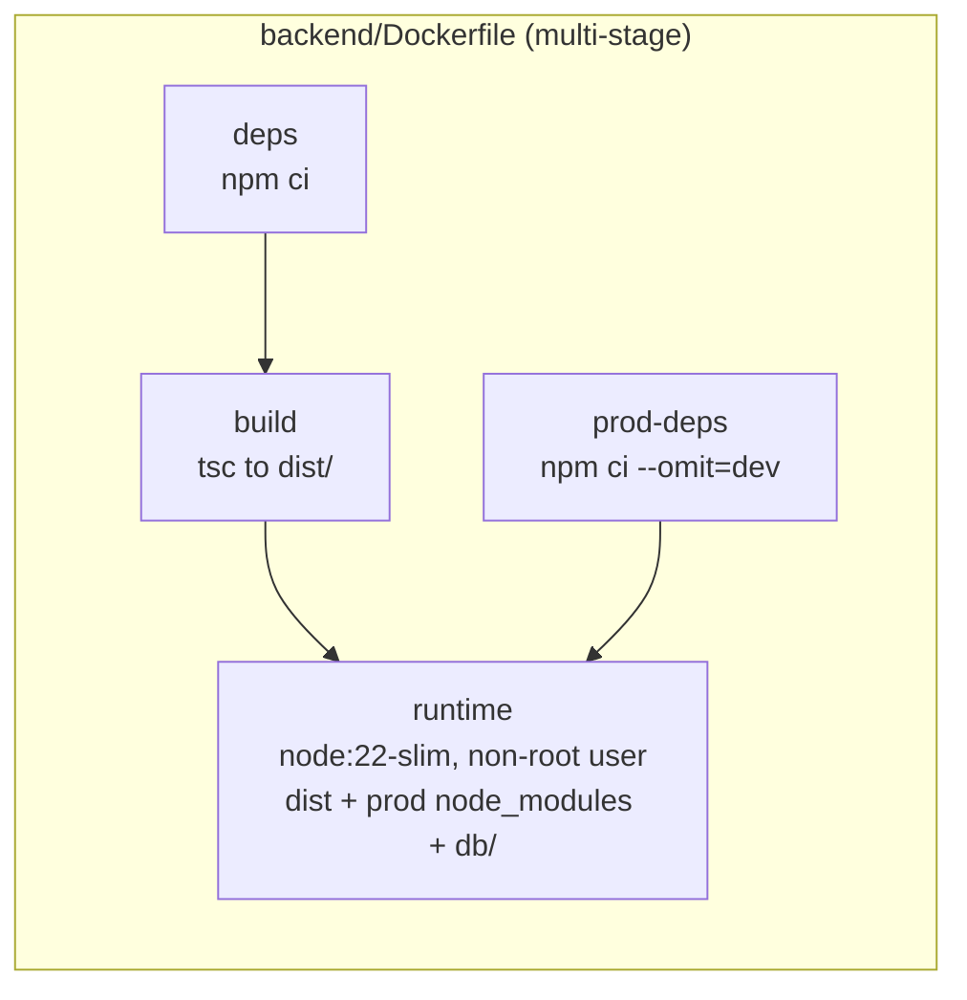
- **Multi-stage**: compilers and dev tools never reach the final image; only compiled JS and production dependencies do.
- **Layer order**: `package*.json` + `npm ci` come before the source, so code-only changes reuse the cached dependency layer.
- **Security/robustness**: runs as the non-root `node` user; exec-form `CMD ["node","dist/server.js"]` (PID 1 gets SIGTERM); `HEALTHCHECK` hits `/api/ready` using Node's built-in `fetch` (no curl in the image); `.dockerignore` keeps `.env`, `node_modules`, tests and perf out.
- **Frontend image**: Next `standalone` output, copies only `.next/standalone`, `.next/static` and `public`; the API address is a **runtime** variable.

### 10.2 Docker Compose (whole stack)

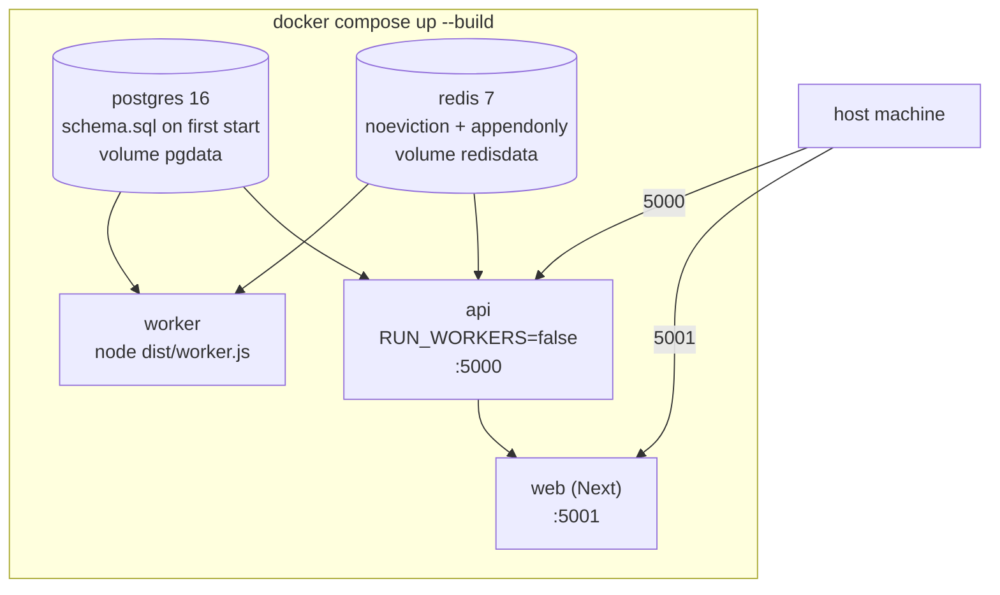
- `depends_on` with `condition: service_healthy` orders startup (databases healthy, then API, then web).
- Secrets (Stripe, Resend, Cloudinary, JWT) come from `backend/.env`; the `environment:` block **overrides** `DATABASE_URL`, `REDIS_URL`, `APP_URL`, so the stack always uses its own Postgres/Redis, never your cloud database.
- Services talk over the compose network by service name (`postgres`, `redis`, `api`); only the API (5000), web (5001) and Postgres (5434) are published to the host.
- Volumes persist data across `down`/`up`; `down -v` wipes it.
- Commands: `docker compose up --build -d`, `docker compose logs -f api`, `docker compose exec api sh`, `docker compose down`.

---

## 11. CI/CD

`.github/workflows/ci.yml` (runs on pull requests and on pushes to `main`/`development`; superseded runs on the same ref are cancelled):

| Job | Steps |
|---|---|
| **backend** | Postgres 16 and Redis 7 **service containers** → `npm ci` → `tsc --noEmit` → `psql -f db/schema.sql` (the same file production uses) → `npm test` (104 tests) with throwaway secrets |
| **frontend** | `npm ci` → `next typegen` (generates `LayoutProps`/`PageProps`, absent from a fresh checkout) → `tsc --noEmit` → `next build` |
| **docker** | Builds both images with layer cache (`type=gha`); no push. Runs after the two jobs above |

CI never sees real secrets; Stripe/Resend/Cloudinary are unset so those code paths use their test doubles. Deployment is continuous on the platform side (Render auto-deploys the watched branch).

---

## 12. Deployment on Render

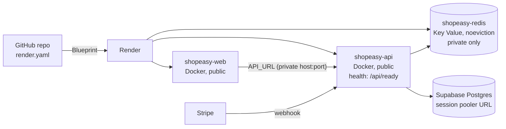
Steps are in `DEPLOYMENT.md`. Essentials:
- **Secrets** are entered in the Render dashboard (`sync: false` in the Blueprint), never committed.
- `TRUST_PROXY=2` (Render's load balancer + the Next proxy) so each visitor has their own rate-limit bucket.
- Apply `backend/db/schema.sql` once to the production database (idempotent).
- Stripe webhook endpoint: `https://<api-host>/api/payments/webhook` with its signing secret in `STRIPE_WEBHOOK_SECRET`.
- Use Supabase's **session pooler** URL (direct connections need IPv6, which Render lacks). URL-encode special characters in the password.
- **Free tier**: services sleep after ~15 min idle (first request ~30 to 60 s; during wake-up the proxy can show 502/520). Background jobs only run while the API is awake. Keep awake with an uptime pinger on `/api/health`, or use a paid plan. Optional separate paid `worker` service is included, commented out, in `render.yaml`.

---

## 13. Configuration reference

**Backend** (`backend/.env`; example in `backend/.env.example`)

| Variable | Required | Purpose / default |
|---|---|---|
| `DATABASE_URL` | yes | Postgres connection string (Supabase session pooler in cloud) |
| `DATABASE_SSL` | no | `false` for local/Compose Postgres (default: SSL on) |
| `JWT_SECRET`, `JWT_REFRESH_SECRET` | yes | Token signing secrets |
| `PORT` | no | 5000 (Render sets its own) |
| `APP_URL` | prod | Public shop URL, used in email links |
| `REDIS_URL` | no | Default `redis://127.0.0.1:6379`; app degrades gracefully without it |
| `REDIS_KEY_PREFIX`, `QUEUE_PREFIX` | no | Namespaces for cache keys / queues |
| `RUN_WORKERS` | no | `false` to run workers in a separate process |
| `STRIPE_SECRET_KEY`, `STRIPE_PUBLISHABLE_KEY` (or `STRIPE_PUBLIC_KEY`), `STRIPE_WEBHOOK_SECRET` | for payments | Without them payment endpoints answer 503 "not configured" |
| `RESEND_API_KEY`, `EMAIL_FROM` | for real email | Console output when no key |
| `CLOUDINARY_URL` or `CLOUDINARY_CLOUD_NAME` + `_API_KEY` + `_API_SECRET` | for uploads | |
| `BULL_BOARD_PASSWORD` | for the dashboard | Dashboard is a 404 when unset |
| `ORDER_PAYMENT_WINDOW_MINUTES` | no | Default 30 |
| `PG_POOL_MAX` | no | Default 10 (keep total across instances under the DB limit) |
| `PG_CONNECT_TIMEOUT_MS` | no | Default 5000, then 503 |
| `PG_STATEMENT_TIMEOUT_MS` | no | Default 15000 |
| `SLOW_QUERY_MS` | no | Default 250 |
| `LOG_LEVEL` | no | `info` default; `silent` in tests |
| `TRUST_PROXY` | prod | Number of proxies in front of the API |
| `RATE_LIMIT_DISABLED` | tests | `1` disables rate limiting |

**Frontend**: `API_URL` (runtime): where the proxy forwards `/api/*` (`http://127.0.0.1:5000` locally; `http://api:5000` in Compose).

---

## 14. Testing

- **104 automated backend tests** (`node:test` via `tsx`, run serially against a real Postgres and Redis): auth flows and token rotation/reuse, concurrency (no overselling, no deadlocks, retry on deadlock), cart and checkout idempotency, payments (signature, duplicates, out-of-order, refunds, reconciliation), cache invalidation and Redis-down behaviour, rate limiting, email outbox/retry, uploads, search/keyset/cursor safety, N+1 query-count guards, index existence, analytics numbers (on orders dated 2001 so real data can't leak in), user administration rules, diagnostics.
- **Test doubles**: Stripe and the email provider are injected; the Redis client can be swapped for a broken one.
- **Run**: `cd backend && npm test`. CI runs the same suite on fresh services.
- **Load/perf**: `backend/perf/` (1M-row seed, EXPLAIN harness, k6 scripts); results in `perf/results/` and `PERFORMANCE.md`.
- **Gap**: no frontend automated tests yet.

---

## 15. Operations runbook

| Symptom | Likely cause and action |
|---|---|
| `502`/`520` on the deployed site after a quiet period | Free-tier API waking up. Wait a minute, or add an uptime pinger / paid plan |
| Every `/api` call from the web returns 500 | Web service can't reach the API: set `API_URL` on the web service (public API URL or the private `host:port`) and redeploy |
| Login 500 | Check `/api/ready`; then the API logs for `"unhandled error"` (usually `DATABASE_URL`: wrong host, direct instead of pooler URL, unencoded password) |
| Bull dashboard 404 | `BULL_BOARD_PASSWORD` not set; set it and restart |
| Emails not arriving | `RESEND_API_KEY` missing (console mode), or `EMAIL_FROM` still the test sender (only delivers to the Resend owner); check the admin **Emails** tab for FAILED rows and errors |
| Payment shows "awaiting payment" after paying | Webhook not reaching the API (`STRIPE_WEBHOOK_SECRET`/endpoint), the reconciler heals it within ~5 min; use the Stripe CLI locally (`stripe listen --forward-to localhost:5000/api/payments/webhook`) |
| `429 Too Many Requests` for everyone | `TRUST_PROXY` wrong, so all users share one IP bucket |
| `503 The server is busy` | DB pool exhausted (queue longer than `PG_CONNECT_TIMEOUT_MS`): raise capacity or investigate slow queries (`[slow query]` log lines, diagnostics) |
| Admin disabled/role-changed user still has access | Redis down (revocation fails open, up to 15 min) |
| Queue warnings about eviction | Redis must be `noeviction` |
| Local ports busy | Stop other dev servers, or `docker compose down` |

Useful URLs: shop `:5001`, API docs `:5000/api/docs`, readiness `/api/ready`, queue dashboard `/api/admin/queues`, diagnostics `/api/admin/diagnostics`.

---

## 16. Design decisions and trade-offs

| Decision | Alternative | Why |
|---|---|---|
| Layered modules (route/controller/service/repository/types) | Fat controllers | Testable rules, SQL isolated, easy to find things |
| Raw SQL with `pg` | ORM | Full control of locks, CTEs, window functions and indexes; this project's goal is learning SQL engineering |
| Transactional **outbox** for emails and refunds | Enqueue after save | Survives crashes and Redis outages; idempotent delivery |
| Webhook as source of truth for payments | Trust the browser redirect | The client can lie or disconnect |
| Keyset pagination + bounded count | OFFSET + exact count | Constant cost at depth; "10,000+" is honest and cheap |
| Versioned cache keys bumped after commit | Delete keys / SCAN | O(1) invalidation with no race that poisons the cache |
| Redis fails **open** for limits and revocation | Fail closed | Availability over strictness; documented 15-minute window |
| Short JWT + hashed rotating refresh tokens | Long-lived JWT / sessions table only | Stateless reads, revocable writes, theft detection |
| Order snapshots | Join to live product data | History must not change when the catalog does |
| Materialized view for daily sales | Aggregate orders on every request | ~365 rows instead of every order; 5-minute staleness accepted |
| Runtime proxy (`proxy.ts`) | `next.config` rewrites | One image for every environment; no build-time address |
| Direct-to-Cloudinary signed uploads | Proxy files through the API | API never handles bytes; secret stays server-side |
| `schema.sql` (idempotent) | Migration tool | Simple for learning; see gaps |

---

## 17. Known gaps and roadmap

**Known gaps**
- No migration tool: `schema.sql` is idempotent but changes are not versioned or reversible. Adopt `node-pg-migrate` (or similar) before real traffic.
- No error tracker (Sentry) and no metrics/alerting stack (Prometheus/Grafana); logs and diagnostics only.
- Refresh-token rotation has no grace window (a lost response forces re-login); login does not require a verified email.
- Revocation has 1-second resolution and fails open when Redis is down.
- No frontend automated tests; no CSV export for reports; the audit log has no UI beyond the user detail API.
- `EMAIL_FROM` needs a verified domain for real customers.
- Tax is 0 (prices tax-inclusive); single currency in practice.
- Free Render tier sleeps; Stripe payment-intent error on the deployed site was reported and still needs the API logs to diagnose.

**Next steps**
1. Merge feature branches into `development`, then `main` through pull requests (CI must be green).
2. Migrations tool, then Sentry, then frontend tests (Playwright for checkout).
3. Verify a sending domain and real Stripe webhook on the deployed site.
4. Always-on worker/API plan, separate cache and queue Redis instances.
5. Optional: refund/returns UI, wishlists and reviews, CSV exports, multi-currency/tax rules.
